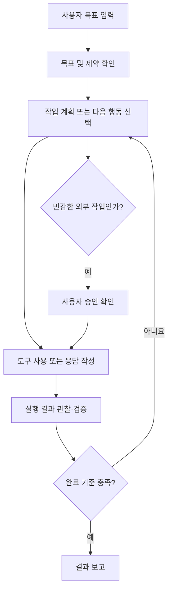

# 01-01. AI Agent란 무엇인가?

- **대상:** AI 입문자·일반 사용자·학생
- **권장 학습 시간:** 40~60분 
- **선수 지식:** 없음. Python 설치도 필요하지 않습니다.

## 🎯 학습 목표

학습 후 다음 질문에 자신의 말로 답할 수 있습니다.

1. AI, 머신러닝, 생성형 AI, LLM, AI Agent는 어떻게 다른가?
2. 일반적인 LLM 대화와 Agent의 작업 수행 방식은 어떻게 다른가?
3. AI Agent가 목표를 달성하기 위해 어떤 과정을 반복하는가?
4. 어떤 일을 Agent에게 맡기고, 어떤 결정은 사람이 확인해야 하는가?

## 1. AI Agent의 개념

**AI Agent(인공지능 에이전트)**는 주어진 목표를 달성하기 위해 상황과 정보를 파악하고, 필요한 작업을 선택하여 실행하며, 실행 결과를 확인하고 다음 행동을 조정하는 AI 기반 시스템입니다.

핵심은 단순히 **질문에 답하는 것**에서 나아가 **목표를 위해 행동하는 것**입니다. 일부 Agent는 검색, 파일 처리, 코드 실행, 외부 서비스 연결 등의 도구를 사용하지만, 모든 Agent가 같은 도구나 높은 자율성을 가지는 것은 아닙니다.

### 일상적인 예시

- **일반적인 대화:** “빵가게 판매 기록을 정리하는 방법을 알려줘.” → 방법을 글로 답변
- **도구를 사용하는 Agent:** “제공한 빵가게 기록에서 판매량과 매출을 계산해줘.” → 허용된 파일을 읽고 계산한 뒤 원본과 합계를 대조
- **중요한 차이:** 예약·메일 발송·결제처럼 실제 세계에 영향을 주는 행동은 사용자 권한과 승인 절차에 따라 실행 여부가 결정됩니다.

> ⚠️ ChatGPT 등의 제품에도 도구 사용 기능이 있을 수 있습니다. **‘챗봇은 답만 하고 Agent만 도구를 쓴다’는 절대적인 구분이 아닙니다.** 도구 사용과 작업 수행 방식, 자율성의 정도에 주목하세요.

## 2. 관련 용어 비교

| 용어 | 핵심 개념 | 간단한 예 |
|---|---|---|
| AI (인공지능) | 기계가 지능적 작업을 수행하도록 하는 넓은 기술 분야 | 이미지 인식, 의사결정 |
| 머신러닝 (ML) | 데이터로부터 패턴을 학습 | 지난 판매 기록으로 내일 필요한 빵의 수량을 예상 |
| 생성형 AI | 텍스트·이미지·코드 등의 새 콘텐츠 생성 | 보고서 초안 생성 |
| LLM (대형 언어 모델) | 언어를 처리·생성하도록 학습된 대규모 모델 | 질의응답, 문장 작성 |
| 챗봇 | 대화 형태의 사용자 인터페이스 또는 서비스 | 고객 상담 채팅 |
| AI Agent | 목표 달성을 위해 작업을 계획·실행·점검하는 시스템 | 빵 판매 기록을 읽고 매출표를 만든 뒤 합계 검산 |

이 분류는 **서로 배타적인 단계가 아닙니다.** 예를 들어, 하나의 AI Agent가 LLM을 핵심 추론 엔진으로 사용하면서 챗봇 인터페이스를 제공할 수 있습니다.

## 3. AI Agent의 주요 구성 요소

1. **목표(Goal):** 해결해야 할 문제와 완료 기준
2. **모델(Model):** 언어 이해, 추론 및 다음 행동 제안
3. **도구(Tools):** 파일 읽기, 검색, 코드 실행, API 등 실제 작업 수단
4. **상태·메모리(State/Memory):** 현재까지의 작업 결과와 필요한 맥락 관리
5. **제어·검증(Control/Evaluation):** 작업 단계 관리, 오류 확인, 중단 및 승인 처리

메모리는 시스템 설계에 따라 짧은 대화 문맥, 작업 상태 또는 장기 저장소 등 다양한 방식으로 구현될 수 있습니다.

### 동작 흐름



위 구조는 이해를 돕기 위한 **개념도**입니다. 실제 Agent에는 계획 단계가 생략될 수 있고, 시스템에 따라 승인·실패 처리 흐름이 다릅니다.

## 4. 챗봇 방식과 Agent 방식 비교

**과제:** “빵가게의 3일 판매 기록을 읽고 판매량·매출·남은 수량을 정리해줘.”

| 비교 항목 | 일반적인 텍스트 대화 | 도구를 갖춘 Agent 작업 |
|---|---|---|
| 입력 | 질문 또는 데이터 요약 | 목표, 파일, 제약 및 완료 기준 |
| 수행 | 분석 방법·예시 코드 설명 | 파일을 읽고 분석 코드 실행 가능 |
| 결과 | 설명·표·코드 제안 | 실행 결과 기반 그래프·보고서 작성 가능 |
| 오류 대응 | 사용자가 오류를 전달해 추가 질문 | 실행 결과를 관찰해 수정·재시도 가능 |
| 검증 | 사용자가 직접 근거 확인 | 자동 점검을 수행해도 최종 검토 필요 |

**주의:** 가능한 작업은 연결된 도구·설정·권한에 따라 달라집니다. 도구가 없다면 AI는 실제 파일을 읽거나 코드를 실행했다고 주장해서는 안 됩니다.

## 5. 실무 적용 사례

### 사례 A. 가게 판매 요약문
3일 기록 확인 → 판매 수량·매출 합산 → 요약문 작성 → 계산 확인 → 사람의 최종 검토

### 사례 B. 준비한 빵과 실제 판매량 비교
날짜·수량·가격 확인 → 빠진 값이나 음수 확인 → 남은 수량 계산 → 그래프 작성 → 원자료와 검산  
남은 빵은 준비 수량에서 판매 수량을 뺀 값입니다. 3일 동안 남은 빵 15개는 일별 마감 잔량의 합이며, 다음 날로 이월한 최종 재고가 아닙니다.

### 사례 C. 주문을 다 받지 못한 날 찾기
주문 수량과 판매 수량 비교 → 부족 수량 계산 → 더 확인할 자료 정리 → 준비 수량 조정안 작성 → 가게 주인 검토  
10월 2일에는 45개를 주문받았지만 40개만 판매해 5개를 채우지 못했습니다. 이 기록만으로 다음 날 수요를 확정할 수는 없습니다.

공통 자료: [가상 데이터·열 이름·계산 정답](../examples/bakery_sales/README.md). 주문 수량은 기록된 요청량이며, 전체 시장 수요를 측정한 값은 아닙니다.

## 6. AI Agent의 장점과 한계

**장점**
- 반복적인 정보 정리와 문서 작성 시간 절감 가능
- 여러 작업을 하나의 목표 아래 연결
- 데이터 분석·코딩의 초안 제작 및 반복 수정 지원

**한계**
- 잘못된 사실, 계산 결과 또는 존재하지 않는 출처를 제시할 수 있음
- 잘못 설계된 목표나 도구 호출은 오류를 확대할 수 있음
- 개인정보·영업비밀·API 키 유출 및 악성 문서 지시(프롬프트 인젝션) 위험
- 높은 비용, 긴 실행 시간, 모델·도구별 사용량 제한 발생 가능

**원칙:** AI가 실행한 작업과 제안만 한 작업을 구분하고, 숫자·출처·코드는 검증합니다. 삭제·발송·구매·대외 공개처럼 되돌리기 어렵거나 영향이 큰 작업은 **사전 승인**을 거칩니다.

## 7. 직접 실습 (Python 불필요)

### 실습 1. 기본 질문과 구조화된 요청 비교

**A. 기본 질문**
```text
AI Agent에 대해 설명해줘.
```

**B. 구조화된 요청**
```text
역할: 너는 일반 사용자와 학생을 위한 AI 활용 강사야.
목표: AI Agent와 일반 LLM 대화의 차이를 이해하고 싶어.
대상: 프로그래밍 경험이 없는 일반 사용자.
입력: 가상의 빵가게 3일 판매 수량은 25개, 40개, 20개야.
요청: 두 방식의 차이를 판매량 합계 85개를 확인하는 사례로 설명해줘.
출력: ① 쉬운 정의 ② 비교표 ③ 업무 사례 2개 ④ 확인 문제 3개.
제약: 전문용어를 쉽게 풀어 쓰고, 실제로 도구를 실행하지 않았다면 실행했다고 말하지 마.
```

**비교 기록:** 두 응답 중 어느 것이 (1) 이해하기 쉬운가 (2) 요구한 형식을 따르는가 (3) 검증 가능한가를 각각 1~5점으로 평가해 보세요.

### 실습 2. Agent 작업 계획 설계

아래 프롬프트를 입력하고 **실행 계획만** 만들어 보세요.

```text
목표: 빵가게 판매 기록 CSV로 판매 수량·매출·남은 빵을 정리하려고 해.
예정된 열: 날짜, 준비수량, 주문수량, 판매수량, 개당가격.
수량 단위는 개, 가격 단위는 원이야.
현재 파일을 제공하지 않았으므로 데이터에 접근하거나 분석을 실행한 척하지 마.
필요한 입력 자료를 먼저 정리하고,
1) 작업을 5단계로 나누고
2) 각 단계에 필요한 도구를 제안하고
3) 결과를 어떻게 검증할지 설명하고
4) 사람의 확인이 필요한 순간을 표시해줘.
결과는 표로 작성해줘.
```

**확인 포인트:** 파일이 없음을 명시했는가? 실행과 계획을 구분했는가? 검증 단계가 포함되었는가?

## 8. 학습 확인 문제

1. LLM과 AI Agent는 동일한 개념인가요?
2. 챗봇과 Agent를 도구 사용 여부로만 완벽히 구분할 수 있나요?
3. Agent에게 목표 외에 완료 기준을 주는 이유는 무엇인가요?
4. 외부 서비스에 메일을 발송하기 전에는 무엇을 확인해야 하나요?
5. 데이터 분석 보고서에서 반드시 사람이 점검해야 할 항목 두 가지는 무엇인가요?

<details>
<summary>정답 및 해설 보기</summary>

1. 아닙니다. LLM은 모델의 종류이고 Agent는 목표 수행을 위한 시스템입니다. Agent에 LLM이 사용될 수 있습니다.
2. 아닙니다. 챗봇도 도구를 사용할 수 있습니다. 시스템 구성과 자율성 정도를 함께 봐야 합니다.
3. 작업이 끝났는지를 판단하고 결과를 평가하기 위해서입니다.
4. 수신자, 내용, 권한 및 사용자 승인 여부를 확인해야 합니다.
5. 예: 입력 데이터 품질, 계산 결과, 그래프 해석, 출처의 신뢰성 중 두 가지입니다.

</details>

## 9. 이번 장 요약

- **LLM은 언어 모델이고, AI Agent는 목표를 수행하는 시스템입니다.**
- Agent의 중요한 특징은 **도구 사용 자체가 아니라 목표에 따라 행동을 선택하고 결과를 반영하는 과정**입니다.
- **좋은 지시 + 적절한 권한 + 결과 검증**이 실무 활용의 핵심입니다.

---

[← 01장 목차](./README.md) · [학습 시작 안내](../00_getting_started/README.md) · [다음 과정: 프롬프트 작성 기초](../02_prompt_engineering/README.md)

